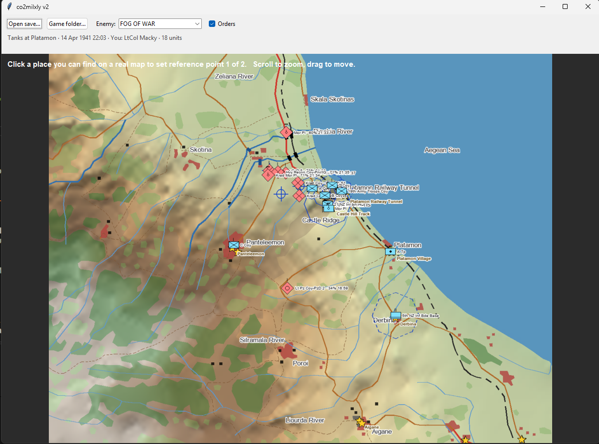
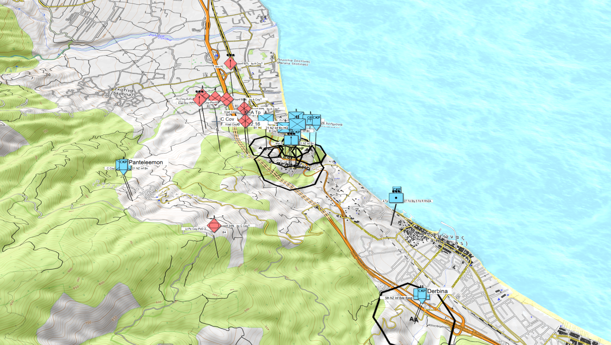
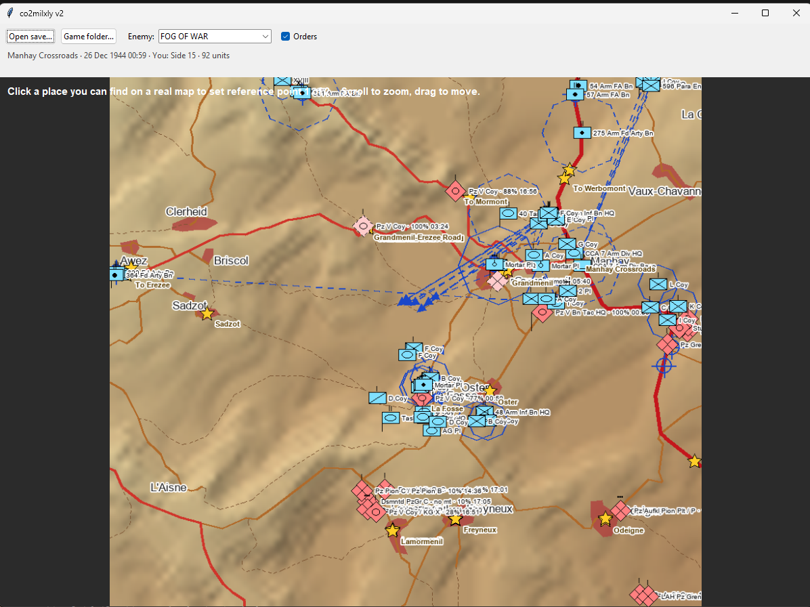
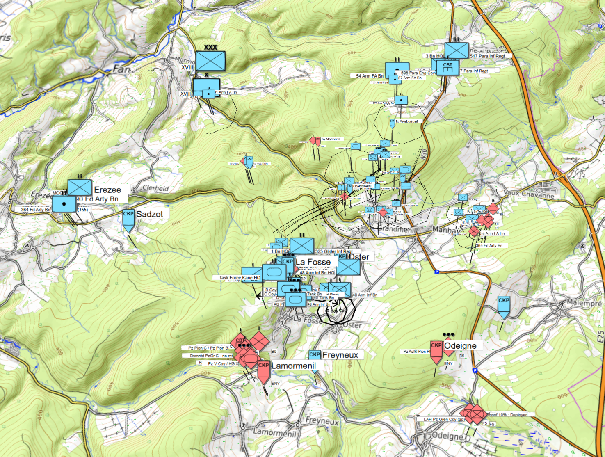

# co2milxly
A small project to convert the KML files generated by Command Ops 2's `GameStateExporter.exe` to MilX file format supported by `map.army`.

## Installation
You need the following on your computer to run this tool:
```
 - python3
 - lxml (pip install lxml)
```

## Examples

### Platamon, 1941, Foothills of the Gods



### Manhay Crossroads, 1944, Battle of the Bulge



## Usage
Open the .exe, and load the save `.cog` file of choice.

You now only have to select two points on the map (preferably, as far away from each other as possible), and then export the data!

## How does it work?
To achieve the generation of KML files, the program links two coordinates in the game(X,Y) against two coordinates in the real life(lat, long). 

Accuracy gets better and better if both of these coordinates are as far away from each other as possible - like the diagonally opposite corners of the map. What it basically does is tells the tool that `x1,y1` in the game maps to `lat1,lon1`; `x2,y2` maps to `lat2,lon2`; and interpolation for any game coordinate to real world WGS84 coordinate is then possible implicitly.

To convert the KML files into a MilX format, this tool uses a custom rule set(inside `co2milx.txt`) to generate MilX units. Since the ruleset is quite small right now, you *might* face errors. To fix this, either:
 - Open a new issue on github
 - Contact Serpent on CO2 discord
 - Open map.army, and then manually check what the code for that unit is, and add it to your local rule set.
